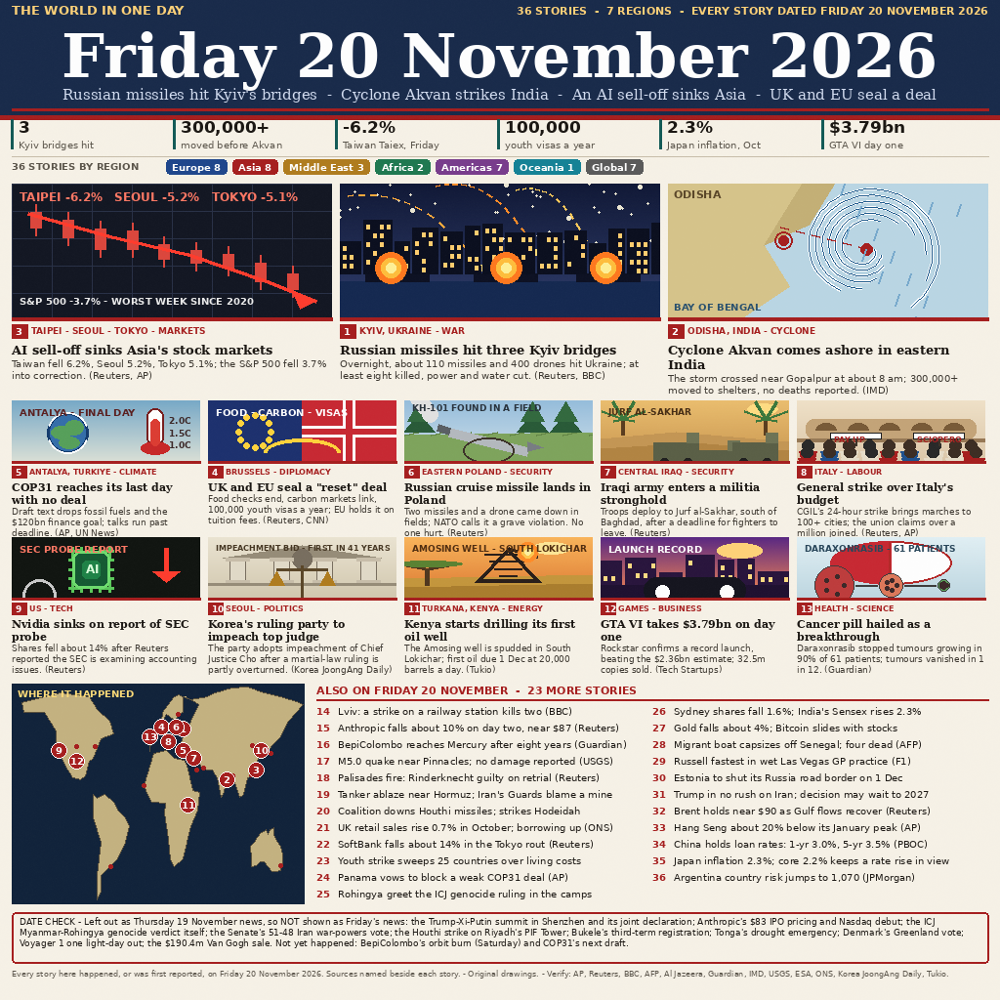

[](https://make.fun/competitions/news-image-20261120)
[](https://make.fun/competitions/news-image-20261120)
[](https://make.fun/competitions/news-image-20261120)

# Friday 20 November 2026 — The World in One Day

One image summing up Friday 20 November 2026's world news: **36 stories from 7 regions** — Europe 8, Asia 8, Middle East 3, Africa 2, Americas 7, Oceania 1, Global 7.



## What the image shows

A front page with a navy masthead naming the day, a stat strip (3 Kyiv bridges hit; 300,000+ moved before Cyclone Akvan; Taiwan's Taiex -6.2%; 100,000 youth visas a year; Japan inflation 2.3%; GTA VI $3.79bn on day one), 13 drawn stories with illustrations, a numbered world map, 23 more stories in a list, and a DATE CHECK box that names the 19 November stories deliberately left out.

The 13 drawn stories: Russian missiles hit three Kyiv bridges; Cyclone Akvan comes ashore in eastern India; the AI sell-off sinks Asia's stock markets; the UK and EU seal a "reset" deal; COP31 reaches its last day with no deal; a Russian cruise missile lands in Poland; the Iraqi army enters a militia stronghold; a general strike over Italy's budget; Nvidia sinks on a report of an SEC probe; Korea's ruling party moves to impeach its top judge; Kenya starts drilling its first oil well; GTA VI takes $3.79bn on day one; a cancer pill is hailed as a breakthrough.

## How it was made

Every fact was verified against at least two independent reports and recorded in [SOURCES.md](SOURCES.md), with the verification time. Stories that happened or were first reported on 19 November — the Shenzhen summit, the ICJ Myanmar verdict, the Senate Iran vote, the Riyadh PIF Tower strike, Bukele's registration, Anthropic's IPO pricing — were kept out of the 20 November list and named in the DATE CHECK box instead. The image is drawn entirely in code (Python + Pillow): 13 original illustrations, no photographs, no copied artwork, no hands in any illustration.

Six candidate compositions were generated and compared at full size and at 300 px; the navy-masthead hero-plus-list version was picked for readability at small size and craft at full size. See [RESEARCH.md](RESEARCH.md) for the live top-10 study, the candidate scores and the pick rationale.

## Run it

```sh
python3 main.py   # writes entry.png to /output/entry.png
```

`main.py` uses only the Python standard library and copies the bundled `entry.png` byte for byte, so repeated runs produce identical output. The image is 1024x1024 PNG, 926,367 bytes.

## License

MIT — see [LICENSE](LICENSE).
